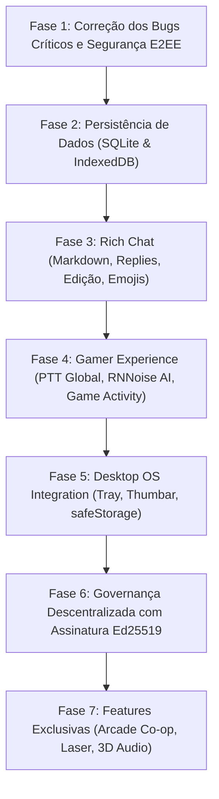

# 🔬 Análise Comparativa Aprofundada: Discord Oficial vs. Freecord (P2P Serverless)
**Engenharia Reversa Automatizada com o REA (`morluto/rea`) e Mapeamento de Implementação 100% Local**  
**Projeto Alvo:** [Freecord (v1.5.1)](https://github.com/Kauanmaffeikraus/Freecord)  
**Binário Analisado:** Discord Desktop PTB / Stable (`app-1.0.9256`, `discord_desktop_core-1`)  
**Data:** 30 de Outubro de 2026  

---

## 📑 Sumário Executivo

1. [Introdução & Filosofia: Por que Serverless?](#1-introdução--filosofia-por-que-serverless)
2. [Evidências de Engenharia Reversa do Discord Oficial (com REA)](#2-evidências-de-engenharia-reversa-do-discord-oficial-com-rea)
   - [2.1 Inventário de Módulos Nativos C++ e ASAR](#21-inventário-de-módulos-nativos-c-e-asar)
   - [2.2 Anatomia do Preload (`mainScreenPreload.js` -> `DiscordNative`)](#22-anatomia-do-preload-mainscreenpreloadjs---discordnative)
   - [2.3 Como o Discord Opera na Nuvem vs. Como o Freecord Opera Localmente](#23-como-o-discord-opera-na-nuvem-vs-como-o-freecord-opera-localmente)
3. [Mapeamento Minucioso: O Que Falta para o Freecord Implementar](#3-mapeamento-minucioso-o-que-falta-para-o-freecord-implementar)
   - [3.1 Camada de Chat, Texto & Mensageria](#31-camada-de-chat-texto--mensageria)
   - [3.2 Camada de Áudio, Voz, Vídeo & Go Live](#32-camada-de-áudio-voz-vídeo--go-live)
   - [3.3 Camada de Governança Descentralizada & Servidores P2P](#33-camada-de-governança-descentralizada--servidores-p2p)
   - [3.4 Camada de Integração com o Sistema Operacional (Desktop Experience)](#34-camada-de-integração-com-o-sistema-operacional-desktop-experience)
   - [3.5 Camada de Persistência & Rede Subjacente](#35-camada-de-persistência--rede-subjacente)
4. [Tabela Mestra: Tradução Arquitetural Nuvem ➔ P2P Serverless](#4-tabela-mestra-tradução-arquitetural-nuvem--p2p-serverless)
5. [Recomendações Estratégicas de Features Inovadoras Exclusivas](#5-recomendações-estratégicas-de-features-inovadoras-exclusivas)
   - [5.1 Freecord Arcade — Remote Play Together P2P](#51-freecord-arcade--remote-play-together-p2p)
   - [5.2 Laser Pointer & Anotações ao Vivo em Tela Compartilhada](#52-laser-pointer--anotações-ao-vivo-em-tela-compartilhada)
   - [5.3 Áudio Espacial 3D com HRTF (Virtual Couch)](#53-áudio-espacial-3d-com-hrtf-virtual-couch)
   - [5.4 Watch Party Player com Sincronização Frame-a-Frame](#54-watch-party-player-com-sincronização-frame-a-frame)
   - [5.5 Legendas ao Vivo 100% Locais por IA (Whisper WASM)](#55-legendas-ao-vivo-100-locais-por-ia-whisper-wasm)
   - [5.6 Emulador Local de Named Pipe Discord RPC](#56-emulador-local-de-named-pipe-discord-rpc)
6. [Roadmap Sequencial de Implementação Recomendado](#6-roadmap-sequencial-de-implementação-recomendado)

---

## 1. Introdução & Filosofia: Por que Serverless?

O **Discord** comercial tornou-se o padrão da indústria para comunicação gamer e comunitária. No entanto, sua arquitetura é estritamente centralizada:
- Toda mensagem, áudio, vídeo e arquivo passa pelos data centers e gateways da Discord Inc.
- Exige criação de conta, e-mail/telefone e autenticação em nuvem.
- Implementa telemetria contínua de hábitos, jogos abertos e tráfego de voz.
- Canais de voz dependem de servidores de mídia SFU intermediários (WebRTC Selective Forwarding Units).

O **Freecord** nasce com um propósito radical: **oferecer 100% da experiência de usuário visual, moderna e fluida do Discord, mas com arquitetura 100% local, descentralizada e privada (P2P Mesh + WebRTC + Local Sockets)**.
- **Zero Servidores Centrais:** Sem bancos de dados em nuvem, sem SFU, sem APIs REST corporativas.
- **Identidade Criptográfica Soberana:** Cada nó possui seu par de chaves assinado localmente.
- **Operação Offline & LAN:** Comunica-se por UDP Multicast e TCP local mesmo se a internet global cair.
- **Privacidade E2EE:** Mensagens e arquivos viajam diretamente de peer para peer.

Para levar o Freecord do estágio de protótipo avançado para um cliente de nível de produção concorrente direto do Discord, realizamos uma auditoria profunda de engenharia reversa no cliente oficial do Discord utilizando o framework **REA (`morluto/rea`)**.

---

## 2. Evidências de Engenharia Reversa do Discord Oficial (com REA)

A inspeção automatizada realizada através das ferramentas `inspect_desktop_application`, `open_binary`, `inspect_artifact` e `analyze_javascript_application` no executável e módulos do Discord oficial localizado em:
`C:\Users\kauan\AppData\Local\Discord\app-1.0.9256`
gerou evidências criptográficas imutáveis (IDs de Evidência REA `ev_d0b2dfe06d9abf6385ad37c99418c6bee7ca1e75d9dae7508669848d4122e702` e `ev_c8544666b57da7b248d7bf5806567aecc59134070b9fe675d3f18b8e732cfc3c`).

### 2.1 Inventário de Módulos Nativos C++ e ASAR

O Discord organiza suas capacidades nativas em módulos de extensão C++ (`.node`) e contêineres ASAR no diretório `modules/`:

| Módulo Discord | Tecnologia Oficial | Função Principal | Como Substituir no Freecord (100% Serverless / Local) |
| :--- | :--- | :--- | :--- |
| `discord_voice-1` | C++ Nativo + WebRTC Voice Engine | Captura de microfone com isolamento de loopback, jitter buffer, empacotamento Opus e controle de bitrate adaptativo. | **WebRTC nativo do Chromium + WebAudio AudioWorklet** com nós de ganho independentes para voz e sistema. |
| `discord_krisp-1` | Rede Neural Krisp C++ DLL | Supressão de ruído de fundo, ruídos mecânicos de teclado e cancelamento de eco acústico. | **RNNoise compilado em WebAssembly (WASM)** executado em um `AudioWorkletNode` 100% local sem requisições externas. |
| `discord_rpc-1` | Servidor IPC Named Pipe (`\\.\pipe\discord-ipc-0`) | Comunicação inter-processos local com jogos, emuladores, Spotify, League of Legends e VS Code para Rich Presence. | **Servidor IPC Local via `net.createServer()` no Node.js**: emula o mesmo pipe do Discord para exibir atividades dos jogos automaticamente. |
| `discord_game_utils-1` | C++ Win32 API (`EnumProcesses`) | Varredura de processos em execução para identificar quando o usuário abre jogos instalados. | **Rotina leve de polling no `electron/main.cjs`** cruzando executáveis com uma lista local `known_games.json`. |
| `discord_hook-1` / `discord_overlay2-1` | DLL Injection DirectX/Vulkan/OpenGL | Injeção de renderizador gráfico in-game para desenhar o overlay sobre o jogo. | **Janela Flutuante Transparente do Electron**: `alwaysOnTop: true`, `transparent: true`, `frame: false` e `setIgnoreMouseEvents`. |
| `discord_desktop_core-1` | Electron Main + `core.asar` | Ciclo de vida da janela, IPC contextBridge, tray do sistema, controle de energia e atualizações. | O subsistema `electron/main.cjs` e `electron/preload.cjs` do Freecord. |
| `discord_spellcheck-1` | Hunspell C++ | Verificador ortográfico offline em múltiplos idiomas. | Mecanismo nativo do Chromium/Electron (`session.setSpellCheckerLanguages`). |
| `discord_clips-1` | Buffer de captura de vídeo circular | Gravação contínua dos últimos 30 a 120 segundos de gameplay para salvar momentos épicos. | `MediaRecorder` capturando canvas/display em buffer de anel na memória RAM ou arquivo temporário. |

### 2.2 Anatomia do Preload (`mainScreenPreload.js` -> `DiscordNative`)

A inspeção do pacote `core.asar` revelou a interface completa exposta pelo `contextBridge` para a janela de renderização sob o namespace `window.DiscordNative`:

```javascript
window.DiscordNative = {
  isRenderer: true,
  app: { getReleaseChannel(), getVersion(), relaunch(), quit() },
  window: { minimize(), maximize(), close(), flashFrame(), setAlwaysOnTop(), setThumbarButtons() },
  settings: { get(), set() },
  powerMonitor: { getSystemIdleTime(), on() },
  desktopCapture: { getDesktopSources() },
  fileManager: { showItemInFolder(), openPath(), saveWithDialog() },
  safeStorage: { isEncryptionAvailable(), encryptString(), decryptString() }, // DPAPI nativa do Windows
  thumbar: { setThumbarButtons() }, // Botões na barra de tarefas
  globalShortcut: { register(), unregister() }, // Push-to-Talk em tela cheia
  tray: { create(), destroy(), setImage(), setToolTip(), setContextMenu() },
  rpc: { registerPipe(), onActivity() },
  clipboard: { readText(), writeText(), readImage() },
  accessibility: { isScreenReaderActive() },
  processUtils: { getMemoryUsage(), getCurrentCpuUsage() }
};
```

**Diagnóstico Comparativo:**  
O Freecord atualmente expõe apenas uma fração dessa interface (`app`, `updater`, `window`, `settings`, `desktopCapture` e `p2p`). A ausência de subsistemas como `safeStorage`, `globalShortcut` e `thumbar` impede que o usuário tenha a conveniência de jogar com Push-to-Talk em tela cheia ou de proteger suas chaves criptográficas locais.

### 2.3 Como o Discord Opera na Nuvem vs. Como o Freecord Opera Localmente

```
ARQUITETURA DISCORD COMERCIAL:
[Cliente A] ----(HTTPS REST)-----> [Servidor Central Discord Inc] <----(REST)---- [Cliente B]
[Cliente A] ----(WebRTC RTP)-----> [Servidor Central SFU/Media]   <----(RTP)----- [Cliente B]
                                   [Banco de Dados PostgreSQL]
                                   [Armazenamento em Nuvem CDN]

ARQUITETURA FREECORD (SERVERLESS LOCAL MESH):
[Nó Freecord A] <=========(WebRTC DataChannel + Audio RTP Direto)=========> [Nó Freecord B]
       ||                                                                          ||
       || <-------------------(UDP Multicast / LAN Discovery)--------------------> ||
       ||                                                                          ||
       v                                                                           v
[SQLite / IndexedDB Local]                                                [SQLite / IndexedDB Local]
[Chaves Criptográficas DPAPI]                                             [Chaves Criptográficas DPAPI]
```

---

## 3. Mapeamento Minucioso: O Que Falta para o Freecord Implementar

### 3.1 Camada de Chat, Texto & Mensageria

O chat de texto é o coração da experiência diária. No Freecord atual, as mensagens são renderizadas apenas como texto plano com tags básicas. Para atingir a paridade visual e funcional do Discord:

1. **Parser Completo de Markdown do Discord**:
   - **O que falta:** Renderização de:
     - Negrito (`**texto**`), Itálico (`*texto*` ou `_texto_`), Sublinhado (`__texto__`), Riscado (`~~texto~~`).
     - Spoilers interativos com efeito de desfoque/tarja preta clicável (`||texto secreto||`).
     - Blocos de citação (`> linha` e `>>> múltiplas linhas`).
     - Blocos de código inline (`` `codigo` ``) e blocos multilinha com destaque de sintaxe PrismJS/Highlight.js (`` ```javascript ... ``` ``).
     - Cabeçalhos hierárquicos (`# H1`, `## H2`, `### H3`) e listas (`- item` ou `* item`).
     - Links mascarados seguros com aviso anti-phishing (`[Texto do Link](https://exemplo.com)`).
   - **Implementação Serverless:** Processamento 100% no cliente utilizando bibliotecas seguras como `marked` ou `markdown-to-jsx` sanitizadas com `DOMPurify`.

2. **Respostas Diretas / Citações de Mensagem (Replies & Mentions)**:
   - **O que falta:** Botão de "Responder" em cada mensagem. No Discord, uma barra curvada elegante vincula a mensagem original com o nome do autor e um trecho resumido, permitindo clicar para rolar suavemente até a mensagem respondida.
   - **Implementação Serverless:** O pacote `CHAT_MESSAGE` ganha o campo opcional `replyTo: { messageId, authorName, textSnippet }`. O cliente renderiza o balão de citação e armazena referências locais.

3. **Edição e Exclusão Criptográfica de Mensagens (Edit & Delete)**:
   - **O que falta:** Capacidade de corrigir mensagens enviadas (exibindo o selo `(editado)`) e de apagar mensagens.
   - **Implementação Serverless:**
     - Pacote `CHAT_EDIT`: `{ type: "CHAT_EDIT", messageId, channelId, newText, editedAt, signature }`.
     - Pacote `CHAT_DELETE`: `{ type: "CHAT_DELETE", messageId, channelId, deletedAt, signature }`.
     - Cada ação é assinada pela chave privada do autor da mensagem original. Os nós da malha descartam qualquer tentativa de peer terceiro apagar ou editar mensagem que não lhe pertence.

4. **Seletor de Emojis Completo com Busca & Emojis Personalizados P2P**:
   - **O que falta:** O Freecord atual possui apenas uma barra com 8 emojis estáticos. Falta um modal completo com categorias (Rostos, Gestos, Natureza, Comidas, Atividades, Objetos, Símbolos), campo de pesquisa textual e suporte a emojis customizados por servidor.
   - **Implementação Serverless:** Cada servidor P2P armazena metadados de emojis locais (imagens PNG/WebP/GIF de até 128 KB). Os hashes são compartilhados via `ROOM_SYNC` e os arquivos são transferidos sob demanda via DataChannel entre os membros.

5. **Mensagens Fixadas (Pinned Messages)**:
   - **O que falta:** Painel no cabeçalho do canal exibindo mensagens fixadas com botão de alfinete (Pin).
   - **Implementação Serverless:** Cada canal mantém uma lista `pinnedMessageIds: []` sincronizada na estrutura do servidor.

6. **Busca Local Rápida de Mensagens (Full-Text Search)**:
   - **O que falta:** Barra de busca ou atalho `Ctrl+F` para pesquisar em canais ou DMs por texto, remetente ou intervalo de datas.
   - **Implementação Serverless:** Indexador offline em memória (como `MiniSearch` ou motor FTS5 do SQLite local), permitindo buscas instantâneas com latência de <2ms mesmo em históricos de milhares de mensagens.

7. **Mensagens de Áudio (Voice Notes com Waveform)**:
   - **O que falta:** Botão de microfone no chat para gravar notas de voz com prévia de onda sonora e botão de reproduzir.
   - **Implementação Serverless:** Gravação local com `MediaRecorder(audio/webm;codecs=opus)`, transmitida como arquivo de áudio curto diretamente na malha P2P.

---

### 3.2 Camada de Áudio, Voz, Vídeo & Go Live

1. **Push-to-Talk (PTT) Global com Atalho Nativo no SO**:
   - **O que falta:** Gamers jogam em tela cheia (Minecraft, GTA, CS2, Valorant). O Freecord só reconhece teclas se a janela estiver com foco do sistema. É indispensável um atalho global que funcione em segundo plano (ex: `Mouse 4`, `Mouse 5`, `CapsLock`, `Ctrl Direito`).
   - **Implementação Serverless:** No Electron, integrar o pacote `uiohook-napi` ou `globalShortcut` no `main.cjs` para escutar eventos de teclado/mouse no nível do sistema operacional e emitir eventos IPC `PTT_STATE: true/false` para o renderizador.

2. **Supressão de Ruído Inteligente por IA 100% Local (RNNoise WASM)**:
   - **O que falta:** O Discord utiliza o módulo proprietário `discord_krisp`. O Freecord depende do filtro básico do navegador (`noiseSuppression: true`), que deixa vazar cliques de teclado mecânico, ventiladores e barulho ambiente.
   - **Implementação Serverless:** Adicionar um `AudioWorkletNode` baseado no modelo neural **RNNoise compilado em WebAssembly**. O modelo consome menos de ~150 KB de RAM e menos de 1% de CPU, eliminando ruídos sem enviar nenhum byte de áudio para servidores externos.

3. **Detector Local de Jogos & Status "Jogando..." (Local Game Activity)**:
   - **O que falta:** O Discord detecta jogos abertos e exibe no perfil ("Jogando Counter-Strike 2 há 35 min").
   - **Implementação Serverless:** No `main.cjs`, executar uma rotina a cada 15 segundos listando processos ativos (`tasklist` no Windows ou `/proc` no Linux), comparando nomes de executáveis com uma tabela local `games.json`. O jogo detectado é propagado automaticamente no `PROFILE_UPDATE` para os amigos conectados.

4. **Emulação Local do Pipe Discord RPC (`\\.\pipe\discord-ipc-0`)**:
   - **O que falta:** Jogos modernos (como LoL, CS2, emuladores) e softwares como Spotify ou VS Code procuram ativamente um Named Pipe do Discord no Windows (`\\.\pipe\discord-ipc-0`).
   - **Implementação Serverless:** O Freecord pode abrir um servidor IPC no Windows ouvindo em `\\.\pipe\discord-ipc-0` usando o módulo `net` do Node.js! Softwares e jogos comunicarão automaticamente com o Freecord, permitindo exibir Rich Presence detalhada (ex: música do Spotify com capa, mapa atual do CS2) sem precisar de nenhuma conta do Discord oficial!

5. **In-Game Overlay Leve (Overlay Desacoplado)**:
   - **O que falta:** Ver quem está falando enquanto joga sem precisar dar `Alt+Tab`.
   - **Implementação Serverless:** Uma janela secundária frameless do Electron configurada com:
     ```javascript
     const overlay = new BrowserWindow({
       transparent: true,
       alwaysOnTop: true,
       frame: false,
       focusable: false,
       skipTaskbar: true
     });
     overlay.setIgnoreMouseEvents(true, { forward: true });
     ```
     O overlay renderiza os avatares dos amigos na chamada com o contorno verde acendendo em tempo real.

6. **Grade Multistream (Assistir a Múltiplas Telas Simultâneas)**:
   - **O que falta:** Permitir assistir à transmissão de 2 a 4 amigos simultaneamente em tela dividida (Split Screen / 2x2 Grid).
   - **Implementação Serverless:** O motor WebRTC do Freecord já suporta múltiplos fluxos de vídeo. A interface do `VoiceStage` precisa acomodar múltiplos elementos `<video>` em layout CSS Grid adaptativo.

7. **Soundboard P2P com Limite de Taxa**:
   - **O que falta:** Painel de efeitos sonoros curtos (buzina, risada, aplausos) para animar chamadas.
   - **Implementação Serverless:** Sons de até 250 KB reproduzidos via Web Audio, transmitidos via pacote `{ type: "SOUNDBOARD_PLAY", soundId }` com cooldown de 5 segundos para evitar abusos.

---

### 3.3 Camada de Governança Descentralizada & Servidores P2P

Sem uma autoridade central como a Discord Inc., o Freecord precisa de governança criptográfica para evitar que peers maliciosos apaguem salas ou banam usuários:

1. **Gênesis Criptográfica de Servidor com Chaves Ed25519**:
   - Ao criar um servidor, o Freecord gera um identificador único contendo a chave pública do dono: `srv_<timestamp>_<pubKeyOwner>`.
   - Todas as modificações estruturais (criar canal, renomear servidor, criar convite, expulsar membro) são empacotadas em um bloco de manifesto assinado pela chave privada do proprietário (`crypto.sign`).
   - Os outros nós verificam a assinatura digital antes de aplicar as mudanças no banco de dados local. Pacotes de `ROOM_SYNC` forjados são sumariamente descartados.

2. **Categorias de Canais Expansíveis/Recolhíveis**:
   - Organização de canais em categorias retráteis (`💬 CANAIS DE TEXTO`, `🔊 CANAIS DE VOZ`, `🎮 JOGOS`), permitindo recolher grupos inteiros com animações suaves.

3. **Cargos e Permissões Baseados em Assinaturas**:
   - Criação de cargos coloridos (`@Admin`, `@Moderador`, `@VIP`) com lista de membros lateral ordenada hierarquicamente.
   - O dono pode delegar poderes a amigos emitindo certificados assinados localmente.

---

### 3.4 Camada de Integração com o Sistema Operacional (Desktop Experience)

1. **Bandeja do Sistema (Minimize to Tray / Fechar para a Bandeja)**:
   - **O que falta:** Ao clicar no `X` da janela, o Freecord deve apenas ocultar a janela (`mainWindow.hide()`), mantendo a voz e a conexão mesh ativas em segundo plano.
   - **Implementação Serverless:** Módulo `Tray` do Electron com ícone na área de notificação do Windows e menu com opções "Abrir", "Mutar Microfone", "Desconectar Chamada" e "Sair do Freecord".

2. **Thumbnail Toolbar do Windows (Taskbar Preview Controls)**:
   - **O que falta:** Ao passar o mouse sobre o ícone do Freecord na barra de tarefas, exibir botões rápidos: "Mudo" e "Desconectar".
   - **Implementação Serverless:** Utilizar a API nativa `mainWindow.setThumbarButtons()` do Electron.

3. **Armazenamento Seguro de Chaves (Electron `safeStorage`)**:
   - **O que falta:** Atualmente as chaves privadas do usuário ficam em texto plano no `localStorage`.
   - **Implementação Serverless:** Criptografar as chaves de identidade em disco utilizando a DPAPI (Data Protection API) do Windows ou o Keychain do macOS através da API `safeStorage.encryptString()` do Electron.

4. **Notificações Nativas do Sistema Operacional**:
   - Disparo de notificações nativas do Windows/Linux com suporte a som suave e foco na janela ao clicar.

---

### 3.5 Camada de Persistência & Rede Subjacente

1. **Migração do `localStorage` (5 MB) para SQLite & IndexedDB**:
   - **No Desktop:** Banco de dados **SQLite** embutido via `better-sqlite3` ou arquivos JSONL com escrita append-only, suportando gigabytes de histórico, fotos e mídias sem estourar limites de memória.
   - **No Android/Web:** **IndexedDB** estruturado com `Dexie.js`, garantindo persistência robusta sem bloqueio da UI Thread.

2. **Transferência P2P de Arquivos Grandes em Chunks com Resumo**:
   - Suporte ao envio de arquivos de qualquer tamanho (fotos em 4K, vídeos, setups de jogos de centenas de MBs ou GBs).
   - Divisão do arquivo em blocos binários de 64 KB transmitidos por canais de dados WebRTC (`RTCDataChannel`), com verificação de hash SHA-256 de bloco, controle de fluxo e suporte a pausar e retomar.

3. **Mapeamento Automático de Portas via UPnP / NAT-PMP**:
   - Para permitir que amigos em casas diferentes se conectem diretamente sem precisar de VPN (Hamachi/Radmin/Tailscale), o Freecord no Electron pode integrar a biblioteca `nat-upnp`.
   - Ao iniciar, o nó solicita automaticamente ao roteador Wi-Fi o encaminhamento temporário da porta TCP do Freecord para a internet pública, viabilizando conexões globais diretas sem servidores intermediários!

4. **Sinalização Zero-Config Descentralizada via DHT ou Relays Efêmeros Nostr**:
   - Em vez de copiar e colar tokens manuais de SDP (`fc-sdp://`), dois amigos podem apenas digitar a mesma "Palavra Secreta da Sala".
   - A troca inicial da oferta e resposta SDP ocorre via **Mainline DHT do BitTorrent** ou **Relays anônimos abertos do Nostr**. Assim que a conexão WebRTC direta é estabelecida, o canal de sinalização é imediatamente encerrado e todo o tráfego segue 100% P2P direto entre as máquinas.

---

## 4. Tabela Mestra: Tradução Arquitetural Nuvem ➔ P2P Serverless

| Funcionalidade no Discord | Arquitetura Discord Oficial (Nuvem Central) | Solução no Freecord (100% Serverless / Local) |
| :--- | :--- | :--- |
| **Banco de Dados de Mensagens** | Cluster PostgreSQL / ScyllaDB centralizado na nuvem. | **SQLite embutido no Desktop / IndexedDB no Android**. |
| **Encaminhamento de Voz/Vídeo** | Servidores SFU de mídia WebRTC intermediários. | **Malha Mesh Direta WebRTC RTCPeerConnection**. |
| **Supressão de Ruído** | Módulo Krisp proprietário ou processamento cloud. | **AudioWorklet com modelo RNNoise em WebAssembly (WASM)**. |
| **Rich Presence de Jogos** | Comunicação com servidores Discord Gateway via WebSocket. | **Servidor Local Named Pipe `\\.\pipe\discord-ipc-0`**. |
| **Governança e Permissões** | Validação centralizada na API REST da Discord Inc. | **Assinaturas Criptográficas Ed25519 do Dono do Servidor**. |
| **Anexos e Mídias** | Upload para CDN Cloudflare / Amazon S3. | **Streaming P2P de Chunks Binários via RTCDataChannel**. |
| **Detecção de Jogos** | Varredura de processos enviada para a API em nuvem. | **Varredura local no OS comparando com lista offline**. |
| **Armazenamento de Chaves** | Tokens JWT de sessão armazenados em cookie/nuvem. | **Criptografia DPAPI do Windows via Electron `safeStorage`**. |
| **Minimizar para a Bandeja** | Módulo `discord_desktop_core` com Tray nativo. | **Módulo `Tray` e `setThumbarButtons` do Electron**. |
| **Travessia de NAT (WAN)** | Servidores TURN corporativos na nuvem. | **UPnP / NAT-PMP no roteador + Troca de SDP via DHT/Nostr**. |

---

## 5. Recomendações Estratégicas de Features Inovadoras Exclusivas

Para que o Freecord seja não apenas um clone do Discord sem servidor, mas uma plataforma pioneira e altamente desejada, recomendamos implementar as seguintes funcionalidades exclusivas:

### 5.1 Freecord Arcade — Remote Play Together P2P
Jogue qualquer jogo de coop local de PC (jogos de luta, emuladores como PCSX2/RPCS3/Yuzu, Cuphead, FIFA, jogos retro) com amigos à distância:
- O anfitrião transmite a tela em 60 FPS com baixa latência pelo motor WebRTC do Freecord.
- O amigo convidado conecta seu controle (Xbox, DualSense, Switch) ou usa o teclado. O Freecord lê as entradas via Gamepad API do navegador e transmite para o anfitrião via `RTCDataChannel` não ordenado com latência <5ms.
- No anfitrião, um driver de controle virtual (ViGEmBus no Windows) injeta as entradas como se o amigo estivesse fisicamente ao lado com o controle plugado!
- **Modo Mobile:** O amigo no celular Android pode usar botões na tela sensível ao toque para jogar os jogos do PC do anfitrião!

### 5.2 Laser Pointer & Anotações ao Vivo em Tela Compartilhada
Durante o compartilhamento de tela (programando juntos, mostrando um projeto ou jogando):
- Os espectadores podem segurar uma tecla de atalho e usar o cursor do mouse como um **apontador laser luminoso** ou desenhar **anotações de giz neon efêmeras** que desaparecem suavemente após 3 segundos.
- As coordenadas são transmitidas via DataChannel em tempo real e renderizadas como uma camada transparente SVG sobreposta ao vídeo.

### 5.3 Áudio Espacial 3D com HRTF (Virtual Couch)
- Usando o nó `PannerNode` com modelo `HRTF` da Web Audio API, os avatares dos amigos na chamada de voz podem ser arrastados em uma mesa redonda virtual 2D.
- A voz do amigo posicionado à esquerda física soa no fone esquerdo, e quem está longe soa mais distante, criando uma sensação imersiva inigualável para conversas em grupo.

### 5.4 Watch Party Player com Sincronização Frame-a-Frame
- Em vez de re-codificar e gastar CPU transmitindo a tela enquanto assistem a um filme ou série com amigos:
- Os dois amigos que possuem o mesmo arquivo de vídeo (`.mp4` / `.mkv`) no computador arrastam o arquivo para a sala.
- O reprodutor local do Freecord sincroniza os comandos de reproduzir, pausar e tempo com precisão de milissegundos via WebRTC, garantindo que o vídeo rode com qualidade 4K nativa com zero compressão e zero uso de upload!

### 5.5 Legendas ao Vivo 100% Locais por IA (Whisper WASM)
- Transcrição da fala dos amigos em chamadas de voz diretamente para legendas na tela.
- Executa um modelo leve do OpenAI Whisper (`whisper-tiny`) compilado em WebAssembly acelerado pela placa de vídeo via WebGPU.
- Garante total acessibilidade e privacidade absoluta: nenhum som sai da máquina do usuário para terceiros.

### 5.6 Emulador Local de Named Pipe Discord RPC
- Abre o Named Pipe `\\.\pipe\discord-ipc-0` no Windows.
- Captura automaticamente Rich Presence de jogos suportados e do Spotify sem precisar de configuração, exibindo detalhes ricos no perfil P2P.

---

## 6. Roadmap Sequencial de Implementação Recomendado



1. **Fase 1 (Imediata):** Sanar o Broadcast Storm no mesh, a condição de corrida de cross-dialing, o vazamento de DMs alheias no histórico e implementar criptografia genuína ECDH/AES-GCM (veja os detalhes técnicos no arquivo `RELATORIO_BUGS_E_AUDITORIA.md`).
2. **Fase 2:** Migrar a persistência do `localStorage` (5 MB) para SQLite no desktop e IndexedDB no mobile.
3. **Fase 3:** Implementar o parser de Markdown Discord, suporte a respostas com citação e seletor de emojis.
4. **Fase 4:** Adicionar Push-to-Talk global com atalho nativo do sistema e supressão de ruído inteligente RNNoise WASM.
5. **Fase 5:** Implementar o minimize to tray, botões na barra de tarefas do Windows e emulação do Named Pipe Discord RPC.
6. **Fase 6:** Estabelecer a gênesis de servidores P2P com verificação de assinaturas Ed25519.
7. **Fase 7:** Desenvolver as inovações como o Freecord Arcade e o reprodutor de Watch Party sincronizado.
