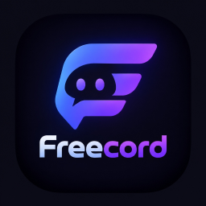

<p align="center">
  
</p>

<h1 align="center">Freecord PTB — Serverless P2P Communication</h1>

<p align="center">
  <strong>Freecord PTB</strong> is a desktop and web communication platform inspired by <strong>DiscordPTB</strong>, engineered to run <strong>100% Peer-to-Peer (Serverless)</strong> — interconnecting computers directly without relying on any central server.
</p>

---

## Key Features

- **Direct P2P Mesh Network (TCP + Gossip Protocol)**:
  - Computers connect directly to one another via `IP:Port` over persistent TCP sockets.
  - Automatic mesh peer exchange (`PEER_EXCHANGE`): connecting to one peer automatically introduces and connects you to other peers in the mesh.
- **Zero-Config LAN & VPN Auto-Discovery (UDP Broadcast & Multicast)**:
  - Automatically discovers and interconnects computers running Freecord on the same Wi-Fi, Ethernet LAN, or virtual LAN VPN (Tailscale, ZeroTier, Radmin VPN, Hamachi) via UDP broadcast (`255.255.255.255:49150`) and multicast (`239.255.42.99:49150`).
- **Full Profile Customization Studio (P2P-Synchronized)**:
  - Customize your **Display Name**, **Username & Tag (`#0001`)**, **Pronouns**, **About Me Bio**, **Presence Status** (`Online`, `Idle`, `Do Not Disturb`, `Invisible`), and **Custom Status Emoji + Text**.
  - Upload custom **Avatar** and **Profile Banner** images (automatically compressed and broadcast directly peer-to-peer with zero central storage).
  - Personalize **2-Tone Profile Theme Gradient Colors** (Primary & Accent) and toggle **Profile Badges** (`P2P Mesh Pioneer`, `Serverless Node`, `E2EE Verified`, `Open Source Builder`, `Voice Mesh Host`, `Zero-Latency Peer`) with a live interactive Profile Card preview.
- **Real-Time Voice, Video & Go Live Screen Sharing (WebRTC P2P Mesh)**:
  - Low-latency Opus voice chat with real-time Voice Activity Detection (speaking green ring indicator), Self Mute, Self Deafen, and per-peer local volume control (`0%–200%`).
  - **Complete Audio, Camera & Screen Share Studio**:
    - Select your **Audio Output Device** (Speaker / Headset via `setSinkId`) with Master Output Volume (`0%–200%`) and built-in audio chime tester.
    - Select your **Microphone Input Device** with a real-time VU input level meter and toggles for **Echo Cancellation**, **Noise Suppression**, and **Automatic Gain Control (AGC)**.
    - Select your **Camera Device** and capture resolution (`480p`, `720p HD`, `1080p Full HD`) with live video preview.
    - Choose your **Go Live Screen Share Resolution** (`720p HD`, `1080p Full HD`, `1440p QHD`, `4K Ultra HD`) and **Frame Rate** (`15 FPS`, `30 FPS`, `60 FPS`).
  - Native desktop/window screen sharing (**Go Live**) powered by Electron's `desktopCapturer` and `getDisplayMedia`.
  - **Serverless WebRTC SDP Invite Codes**: Connect two computers across the internet or strict NATs by exchanging compact Base64 SDP Offer/Answer tokens without port forwarding or signaling servers.
- **Cryptographic Pairwise Fingerprints**:
  - Generates deterministic SHA-256 MLS-style pairwise fingerprints between connected peers.
- **Synchronized P2P Rooms, Channels, Direct Messages & File Sharing**:
  - Create rooms, text channels, and voice channels that synchronize across connected peers (`ROOM_SYNC`).
  - Send inline images and files (up to 15 MB) directly peer-to-peer, with real-time emoji reactions and typing indicators.
- **Multi-Language Support (English & Portuguese)**:
  - Built-in `EN` / `PT-BR` language switcher in the titlebar and user settings.

---

## Architecture Overview

| Layer | File | Description |
| :--- | :--- | :--- |
| **Native P2P Engine** | `electron/p2pNode.cjs` | Node.js TCP mesh server/client, UDP broadcast/multicast discovery beacon, peer gossip (`PEER_EXCHANGE`), RTT ping/pong, and SHA-256 pairwise fingerprint generator. |
| **Electron Main** | `electron/main.cjs` | Frameless window management, persistent window bounds/settings (`settings.json`), `desktopCapturer` screen-share source enumeration, and multi-instance launcher (`--peer-instance=<id>`). |
| **Preload Bridge** | `electron/preload.cjs` | `contextBridge` surface (`window.DiscordNative`) exposing window controls, settings, desktop capture, and P2P IPC channels. |
| **WebRTC Voice Engine** | `src/services/webrtcVoiceEngine.js` | `RTCPeerConnection` + `RTCDataChannel` mesh manager, Web Audio API Voice Activity Detection, per-peer gain control, camera & Go Live screen tracks, and manual SDP invite token generator. |
| **Desktop/Web UI** | `src/App.jsx`, `src/styles.css` | DiscordPTB-styled interface with bilingual (`EN` / `PT-BR`) support. |

---

## Getting Started

### Prerequisites
- **Node.js** `>= 20` (recommended `v22+`)
- **npm**

### Install & Run

```bash
npm install
npm start
```

Or on Windows, double-click **`Start-Freecord.bat`** (or `Iniciar-Freecord.bat`).

### Testing Multi-Peer P2P on a Single Computer

You can launch a second independent peer instance on the same computer to test automatic discovery, chat, file transfer, voice, and Go Live screen sharing immediately:

```bash
npm run peer2
```

Or click **"Spawn 2nd Local Peer"** (`Abrir 2º Peer Local`) directly in the Freecord top titlebar.

---

## License

MIT
