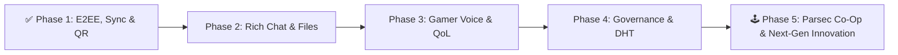

# 🗺️ Freecord PTB — Project Roadmap

This document tracks all implemented milestones in **Freecord PTB** and outlines the strategic roadmap for upcoming features and next-generation P2P innovations.

---

## ✅ Completed Milestones (Implemented)

### 1. 🖧 Decentralized P2P & Mesh Networking
- [x] **Direct TCP Mesh & Gossip Protocol**: Persistent peer-to-peer TCP connections with automatic peer table gossip (`PEER_EXCHANGE`).
- [x] **Zero-Config LAN & VPN Auto-Discovery**: Automatic discovery over local Wi-Fi, Ethernet, and virtual LANs (Tailscale, ZeroTier, Radmin VPN, Hamachi) via UDP broadcast (`255.255.255.255:49150`) and multicast (`239.255.42.99:49150`).
- [x] **Hybrid 1-Byte Peeking TCP + WebSocket Server**: Single-port router (`electron/p2pNode.cjs`) accepting both raw TCP sockets (Desktop-to-Desktop) and WebSocket `/p2p` connections (Android/Web-to-Desktop) simultaneously.
- [x] **Serverless WebRTC SDP Invite Tokens (`fc-sdp://`)**: Direct NAT traversal and cross-network pairing via copy-pasteable Base64 Offer/Answer codes and `RTCDataChannel` messaging without central signaling servers.
- [x] **Remembered LAN Peers**: Automatic persistence of previously connected LAN hosts for 1-click reconnection on Desktop and Mobile.
- [x] **SHA-256 Pairwise Fingerprints**: Deterministic cryptographic identity verification between connected nodes.

### 2. 🔐 Phase 1: Cryptography, Offline Sync & QR Code Pairing
- [x] **End-to-End Encryption (E2EE)**: Automatic cryptographic keypair generation (`X25519`/`ECDH` + authenticated `AES-256` / `SHA-256-CTR-HMAC` envelope) for 1-on-1 DMs and private channels with verified `🔒 E2EE` badges.
- [x] **Offline Message History Sync (`HISTORY_SYNC`)**: Automatic delta synchronization when peers reconnect, fetching missed channel and DM messages from online peers without duplicates.
- [x] **QR Code Device Pairing (PC ↔ Android)**: Instant camera QR Code scanner and dynamic QR generator (`fc-lan://` & invite payloads) to connect Android phones to Desktop nodes or import servers in 1 second with zero typing.
- [x] **Portable Identity Backup (`.freecord-id`)**: Export and import encrypted/signed account bundles (profile, cryptographic keys, servers, and known LAN hosts) across devices.

### 3. 🎙️ Voice, Video & 60 FPS Go Live Screen Sharing
- [x] **Low-Latency Opus Voice Engine**: Real-time WebRTC voice mesh with WebAudio Voice Activity Detection (VAD) and animated speaking indicators.
- [x] **Simultaneous Webcam + Screen Share Stage**: Broadcast and watch multiple cameras and screen streams concurrently.
- [x] **Go Live Quality Selector**: Stream entire monitors or individual application windows at `720p`, `1080p`, `1440p`, or `4K` at `15`, `30`, or `60 FPS`.
- [x] **Interactive Stage Layouts**: Spotlight/Focus view, Theater mode, Grid mode, resizable stage height, native Picture-in-Picture (PiP), and draggable webcam overlay.
- [x] **Digital Zoom & Aspect Controls**: Fit (`contain`) vs. Fill (`cover`) toggle and interactive zoom (`100%` to `200%`).
- [x] **Dual Independent Audio Mixers**: Separate per-peer volume sliders (`0%–200%`) for **Microphone Voice (`🎙️`)** and **Screen/Game Audio (`🖥️`)**.
- [x] **Loopback Audio Echo Isolation**: Automatic WebAudio routing that isolates remote viewers' voices from system desktop audio loopback so viewers never hear their own voice echoed back while watching a stream.
- [x] **Cross-Device Video Rendering Fixes**: Explicit `video/VP8` transceivers and stream re-binding to prevent black screens across heterogeneous GPUs and OSes.

### 4. 📞 Private 1-on-1 DM Calls & Messaging
- [x] **Direct Messaging (DMs)**: Private 1-on-1 conversations with connected peers.
- [x] **1-Click Voice & Video DM Calls**: Full P2P call signaling (`DM_CALL_RING`, `DM_CALL_ACCEPT`, `DM_CALL_REJECT`, `DM_CALL_END`).
- [x] **Incoming & Outgoing Call UI**: Pulsing avatar modal with synthesized ringtone loop, ringback tones, and instant media cleanup on hangup.

### 5. 🏰 P2P Servers, Channels & Invites
- [x] **Server Customization Studio**: Custom server names, acronyms, tags (`✦ P2P`, `✦ SQUAD`, `✦ MESH`), descriptions, icons, banners, and 2-tone gradient themes.
- [x] **Multi-Channel Architecture**: Create, edit, and synchronize multiple text and voice channels per server via `ROOM_SYNC`.
- [x] **Interactive DM Invite Cards**: Send 1-click server invites that render as rich Discord-style embed cards in DMs.
- [x] **Shareable Server Invite Codes (`fc-srv://`)**: Self-contained Base64 invite tokens containing server metadata and host connection endpoints.
- [x] **Leave Server Persistence**: Client-side state tracking (`freecord_left_rooms_v1`) ensuring left servers are not re-added during passive mesh syncs.

### 6. 👤 Profile Customization & Media Studio
- [x] **Animated GIF Support**: Upload animated `.gif` avatars, profile banners, and server icons/banners without losing animation frames.
- [x] **Rich User Profiles**: Customizable Display Name, Username, `#Tag`, Pronouns, Bio, Presence Status (`Online`, `Idle`, `DND`, `Invisible`), Custom Status Emoji/Text, and Badges.
- [x] **Hardware Media Controls**: Audio output selector (`setSinkId`), microphone input selector with live VU meter, DSP toggles (Echo Cancellation, Noise Suppression, AGC), and camera preview with resolution selector.

### 7. 📎 File Sharing, Notifications & Localization
- [x] **Direct P2P File Transfers**: Send images, screenshots, and documents up to 15 MB directly peer-to-peer with inline previews.
- [x] **Synthesized WebAudio Notification Engine**: Zero-dependency procedural sound effects for messages, invites, ringtones, and voice state changes.
- [x] **Desktop & In-App Alerts**: Unread counters, clickable toast notifications, OS notification integration, and taskbar window flashing (`flashFrame`).
- [x] **Bilingual UI (EN / PT-BR)**: Instant switching between English and Portuguese.

### 8. 📦 Cross-Platform Distribution, Mobile APK & Auto-Update
- [x] **Windows & Linux Installers**: Configured `electron-builder` targets for Windows (`NSIS` installer + `Portable` executable) and Linux (`AppImage` + `.deb` package).
- [x] **GitHub Releases OTA Auto-Updater**: Integrated `electron-updater` with in-app download progress and 1-click restart-to-update, automated via GitHub Actions (`.github/workflows/release.yml`).
- [x] **Native Android App (APK)**: Capacitor Android build with runtime microphone/camera permissions and a dedicated **Discord Mobile-inspired UI** featuring bottom tab navigation (`Servers`, `DMs`, `LAN/P2P`, `Profile`), slide-over channel/member drawers, and compact voice sheets.

---

## 🚀 Upcoming Roadmap (Planned Phases)



### 💬 Phase 2: Rich Chat & File Transfer Enhancements
1. **Message Reactions, Replies, Edit & Delete**
   - Add emoji reactions (`👍`, `❤️`, `🔥`, etc.), inline **Reply / Quote** to specific messages, plus **Edit** and **Delete** synchronization across peers.
2. **Markdown, Code Syntax Highlighting & Voice Notes**
   - Render Markdown (`**bold**`, `*italic*`, `||spoilers||`, and syntax-highlighted ` ```code``` ` blocks).
   - Add a **Voice Message (Hold-to-Record)** button in the chat bar to send quick Opus audio clips in text channels and DMs.
3. **Chunked Large File Streaming (>100 MB / 1 GB+)**
   - Upgrade P2P file transfers to **chunked binary streaming** over WebRTC DataChannels or TCP streams with progress bars, speed indicators, and pause/resume.

### 🎮 Phase 3: Advanced Voice, Stage & Desktop Integration
4. **Global Keybinds & Push-to-Talk (PTT)**
   - Register customizable system-wide hotkeys via Electron `globalShortcut` (e.g., `Ctrl+Shift+M` to Mute, `Ctrl+Shift+D` to Deafen, or a dedicated **Push-to-Talk** key while playing fullscreen games).
5. **AI Noise Suppression (RNNoise / WebAssembly)**
   - Integrate a client-side `RNNoise` AudioWorklet processor to eliminate keyboard clicks, fan noise, and background chatter with near-zero CPU overhead.
6. **Multi-Stream Watch Party (Split-Screen Stage)**
   - Allow watching 2 to 4 friends' Go Live screen shares simultaneously in a split-screen grid layout.
7. **System Tray (Minimize to Tray)**
   - Keep Freecord running quietly in the Windows/Linux system tray with quick-action context menus (Mute, Deafen, Status, Quit) when closing the main window.

### 🌐 Phase 4: Decentralized Discovery & Server Governance
8. **Cryptographic Roles & Moderation (Owner / Admin Signatures)**
   - Sign server structural updates (`ROOM_SYNC`, channel creation/deletion, role assignments, peer kicks) with the server creator's private key so unauthorized peers cannot tamper with server settings.
9. **Zero-Code Internet Discovery (DHT / Nostr Signaling Bridge)**
   - Add an optional **BitTorrent Mainline DHT** or lightweight **WebTorrent/Nostr tracker** mode so friends over the internet can find each other and exchange WebRTC SDP handshakes automatically using a shared "Room Passphrase" without manually copying and pasting SDP codes.

---

## 🕹️ Phase 5: Next-Gen Innovations & Parsec-Style Remote Co-Op (Future Vision)

To make **Freecord PTB** a truly unique powerhouse that goes beyond traditional chat apps, Phase 5 focuses on ultra-low-latency interactive experiences:

### 1. 🎮 Freecord Arcade — Parsec-Style P2P Remote Play Together
Play local couch co-op games (fighting games, emulators, platformers, split-screen indie games) with friends over the network as if they were sitting next to you:
- **Ultra-Low-Latency Unordered WebRTC Input Channel**: Capture the guest's physical controller via the HTML5 **Gamepad API** (Xbox, PlayStation DualSense, Switch Pro, or Android mobile touch-gamepad overlay) and transmit button/axis states at `120 Hz` over an unreliable, unordered WebRTC `RTCDataChannel` (`maxRetransmits: 0`) for sub-millisecond input overhead.
- **Virtual Controller & Input Injection on Host**:
  - **Gamepad Isolation Mode (Recommended & Safe)**: Emulate up to 4 virtual Xbox 360 / DualShock 4 controllers on the host PC (via `ViGEmBus` on Windows or `uinput` on Linux), or map guest controllers to dedicated keyboard keys (`WASD` vs `Arrow Keys` / Numpad) so guests can only control the game and cannot access the host's desktop.
  - **Co-Pilot Keyboard & Mouse Mode**: Optional toggle to grant a trusted friend relative mouse and keyboard control inside the shared application window, with an instant **Host Panic Hotkey (`Ctrl+Alt+Backspace`)** to revoke all remote inputs immediately.
- **Mobile Virtual Controller on Android**: When watching a PC friend's game stream on the Freecord Android app, toggle an **On-Screen Touch Gamepad Overlay** (D-Pad, Analog Sticks, A/B/X/Y, L1/R1/L2/R2) to play PC couch co-op games directly from your smartphone!

### 2. 🎧 3D Spatial Audio Stage (Virtual Couch / Room)
- **HRTF Binaural Positional Audio**: Use WebAudio `PannerNode` (`panningModel: "HRTF"`) to position friends' voices in 3D space.
- **Interactive 2D/3D Lounge**: Drag your avatar around a virtual campfire, gaming couch, or study table—friends sitting to your left sound like they are on your left, and moving closer or further dynamically adjusts voice proximity volume.

### 3. 🖍️ Live Screen Annotation & Co-Debugging Laser Pointer
- **Draw on Shared Screens**: While a friend is sharing their screen (coding, gaming, or designing), viewers can hold a key to shine a **real-time laser pointer** or draw temporary **disappearing neon ink annotations** rendered as a transparent SVG overlay on the broadcaster's screen.

### 4. 🍿 Frame-Synchronized P2P Watch Party Player
- **Local Media Sync**: Drag and drop any local `.mp4` / `.mkv` / `.webm` video file into a voice channel stage. Freecord streams and synchronizes play, pause, and seek timestamps across all connected peers within `<25ms` so everyone laughs and reacts at the exact same frame.

### 5. 🧠 100% Local AI Live Captions & Translation (Whisper WASM)
- **Offline Real-Time Subtitles**: Optional WebAssembly `Whisper-tiny` model running locally on the GPU/CPU to generate live closed captions for voice channels—ideal for accessibility, noisy environments, or real-time translation between languages without sending voice data to any cloud server.
