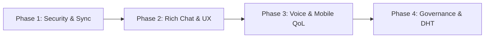

# 🗺️ Freecord PTB — Project Roadmap

This document tracks all implemented milestones in **Freecord PTB** and outlines the strategic roadmap for upcoming features and architectural improvements.

---

## ✅ Completed Milestones (Implemented)

### 1. 🖧 Decentralized P2P & Mesh Networking
- [x] **Direct TCP Mesh & Gossip Protocol**: Persistent peer-to-peer TCP connections with automatic peer table gossip (`PEER_EXCHANGE`).
- [x] **Zero-Config LAN & VPN Auto-Discovery**: Automatic discovery over local Wi-Fi, Ethernet, and virtual LANs (Tailscale, ZeroTier, Radmin VPN, Hamachi) via UDP broadcast (`255.255.255.255:49150`) and multicast (`239.255.42.99:49150`).
- [x] **Hybrid 1-Byte Peeking TCP + WebSocket Server**: Single-port router (`electron/p2pNode.cjs`) accepting both raw TCP sockets (Desktop-to-Desktop) and WebSocket `/p2p` connections (Android/Web-to-Desktop) simultaneously.
- [x] **Serverless WebRTC SDP Invite Tokens (`fc-sdp://`)**: Direct NAT traversal and cross-network pairing via copy-pasteable Base64 Offer/Answer codes and `RTCDataChannel` messaging without central signaling servers.
- [x] **Remembered LAN Peers**: Automatic persistence of previously connected LAN hosts for 1-click reconnection on Desktop and Mobile.
- [x] **SHA-256 Pairwise Fingerprints**: Deterministic cryptographic identity verification between connected nodes.

### 2. 🎙️ Voice, Video & 60 FPS Go Live Screen Sharing
- [x] **Low-Latency Opus Voice Engine**: Real-time WebRTC voice mesh with WebAudio Voice Activity Detection (VAD) and animated speaking indicators.
- [x] **Simultaneous Webcam + Screen Share Stage**: Broadcast and watch multiple cameras and screen streams concurrently.
- [x] **Go Live Quality Selector**: Stream entire monitors or individual application windows at `720p`, `1080p`, `1440p`, or `4K` at `15`, `30`, or `60 FPS`.
- [x] **Interactive Stage Layouts**: Spotlight/Focus view, Theater mode, Grid mode, resizable stage height, native Picture-in-Picture (PiP), and draggable webcam overlay.
- [x] **Digital Zoom & Aspect Controls**: Fit (`contain`) vs. Fill (`cover`) toggle and interactive zoom (`100%` to `200%`).
- [x] **Dual Independent Audio Mixers**: Separate per-peer volume sliders (`0%–200%`) for **Microphone Voice (`🎙️`)** and **Screen/Game Audio (`🖥️`)**.
- [x] **Loopback Audio Echo Isolation**: Automatic WebAudio routing that isolates remote viewers' voices from system desktop audio loopback so viewers never hear their own voice echoed back while watching a stream.
- [x] **Cross-Device Video Rendering Fixes**: Explicit `video/VP8` transceivers and stream re-binding to prevent black screens across heterogeneous GPUs and OSes.

### 3. 📞 Private 1-on-1 DM Calls & Messaging
- [x] **Direct Messaging (DMs)**: Private 1-on-1 conversations with connected peers.
- [x] **1-Click Voice & Video DM Calls**: Full P2P call signaling (`DM_CALL_RING`, `DM_CALL_ACCEPT`, `DM_CALL_REJECT`, `DM_CALL_END`).
- [x] **Incoming & Outgoing Call UI**: Pulsing avatar modal with synthesized ringtone loop,ringback tones, and instant media cleanup on hangup.

### 4. 🏰 P2P Servers, Channels & Invites
- [x] **Server Customization Studio**: Custom server names, acronyms, tags (`✦ P2P`, `✦ SQUAD`, `✦ MESH`), descriptions, icons, banners, and 2-tone gradient themes.
- [x] **Multi-Channel Architecture**: Create, edit, and synchronize multiple text and voice channels per server via `ROOM_SYNC`.
- [x] **Interactive DM Invite Cards**: Send 1-click server invites that render as rich Discord-style embed cards in DMs.
- [x] **Shareable Server Invite Codes (`fc-srv://`)**: Self-contained Base64 invite tokens containing server metadata and host connection endpoints.
- [x] **Leave Server Persistence**: Client-side state tracking (`freecord_left_rooms_v1`) ensuring left servers are not re-added during passive mesh syncs.

### 5. 👤 Profile Customization & Media Studio
- [x] **Animated GIF Support**: Upload animated `.gif` avatars, profile banners, and server icons/banners without losing animation frames.
- [x] **Rich User Profiles**: Customizable Display Name, Username, `#Tag`, Pronouns, Bio, Presence Status (`Online`, `Idle`, `DND`, `Invisible`), Custom Status Emoji/Text, and Badges.
- [x] **Hardware Media Controls**: Audio output selector (`setSinkId`), microphone input selector with live VU meter, DSP toggles (Echo Cancellation, Noise Suppression, AGC), and camera preview with resolution selector.

### 6. 📎 File Sharing, Notifications & Localization
- [x] **Direct P2P File Transfers**: Send images, screenshots, and documents up to 15 MB directly peer-to-peer with inline previews.
- [x] **Synthesized WebAudio Notification Engine**: Zero-dependency procedural sound effects for messages, invites, ringtones, and voice state changes.
- [x] **Desktop & In-App Alerts**: Unread counters, clickable toast notifications, OS notification integration, and taskbar window flashing (`flashFrame`).
- [x] **Bilingual UI (EN / PT-BR)**: Instant switching between English and Portuguese.

### 7. 📦 Cross-Platform Distribution, Mobile APK & Auto-Update
- [x] **Windows & Linux Installers**: Configured `electron-builder` targets for Windows (`NSIS` installer + `Portable` executable) and Linux (`AppImage` + `.deb` package).
- [x] **GitHub Releases OTA Auto-Updater**: Integrated `electron-updater` with in-app download progress and 1-click restart-to-update, automated via GitHub Actions (`.github/workflows/release.yml`).
- [x] **Native Android App (APK)**: Capacitor Android build with runtime microphone/camera permissions and a dedicated **Discord Mobile-inspired UI** featuring bottom tab navigation (`Servers`, `DMs`, `LAN/P2P`, `Profile`), slide-over channel/member drawers, and compact voice sheets.

---

## 🚀 Upcoming Roadmap (Suggested Next Steps)

Below are the highest-impact features recommended for future iterations of Freecord PTB, organized by strategic phase:



### 🔐 Phase 1: Cryptography, Identity & Offline Synchronization (High Priority)
1. **End-to-End Encryption (E2EE)**
   - Generate persistent `Ed25519` (signing) and `X25519` (Diffie-Hellman key exchange) keypairs per user.
   - Encrypt all 1-on-1 DM messages and private server packets using `AES-256-GCM` so relay peers in the mesh cannot read private traffic.
2. **CRDT / Offline Message History Sync**
   - Currently, peers receive messages sent while they are actively connected. Implementing a lightweight **Merkle-DAG or CRDT log sync** (`HISTORY_SYNC`) will allow a returning peer to automatically fetch missed channel messages from any online member of that server.
3. **QR Code Device Pairing & Identity Backup (PC ↔ Android)**
   - Display a dynamic **QR Code** on the PC's P2P Connect modal containing the local `IP:Port` (or WebRTC SDP Offer) and optionally exportable profile keys.
   - Add a **QR Scanner on Android** so connecting the phone to the computer or cloning your profile takes 1 second with the camera—zero typing required.

### 💬 Phase 2: Rich Chat & File Transfer Enhancements
4. **Message Reactions, Replies, Edit & Delete**
   - Add emoji reactions (`👍`, `❤️`, `🔥`, etc.) synced via P2P packets (`MSG_REACT`).
   - Support inline **Reply / Quote** to specific messages, plus **Edit** and **Delete** synchronization across peers.
5. **Markdown, Code Syntax Highlighting & Voice Notes**
   - Render Markdown (`**bold**`, `*italic*`, `||spoilers||`, and syntax-highlighted ` ```code``` ` blocks).
   - Add a **Voice Message (Hold-to-Record)** button in the chat bar (especially handy on the Android mobile UI) to send quick Opus audio clips in text channels and DMs.
6. **Chunked Large File Streaming (>100 MB / 1 GB+)**
   - Upgrade P2P file transfers from single-packet Base64 payloads to **chunked binary streaming** over WebRTC DataChannels or TCP streams with progress bars, speed indicators, and pause/resume.

### 🎮 Phase 3: Advanced Voice, Stage & Desktop Integration
7. **Global Keybinds & Push-to-Talk (PTT)**
   - Register customizable system-wide hotkeys via Electron `globalShortcut` (e.g., `Ctrl+Shift+M` to Mute, `Ctrl+Shift+D` to Deafen, or a dedicated **Push-to-Talk** key while playing fullscreen games).
8. **AI Noise Suppression (RNNoise / WebAssembly)**
   - Integrate a client-side `RNNoise` AudioWorklet processor to eliminate keyboard clicks, fan noise, and background chatter with near-zero CPU overhead.
9. **Multi-Stream Watch Party (Split-Screen Stage)**
   - Allow watching 2 to 4 friends' Go Live screen shares simultaneously in a split-screen grid layout.
10. **System Tray (Minimize to Tray)**
    - Keep Freecord running quietly in the Windows/Linux system tray with quick-action context menus (Mute, Deafen, Status, Quit) when closing the main window.

### 🌐 Phase 4: Decentralized Discovery & Server Governance
11. **Cryptographic Roles & Moderation (Owner / Admin Signatures)**
    - Sign server structural updates (`ROOM_SYNC`, channel creation/deletion, role assignments, peer kicks) with the server creator's private key so unauthorized peers cannot tamper with server settings.
12. **Zero-Code Internet Discovery (DHT / Nostr Signaling Bridge)**
    - Add an optional **BitTorrent Mainline DHT** or lightweight **WebTorrent/Nostr tracker** mode so friends over the internet can find each other and exchange WebRTC SDP handshakes automatically using a shared "Room Passphrase" without manually copying and pasting SDP codes.
